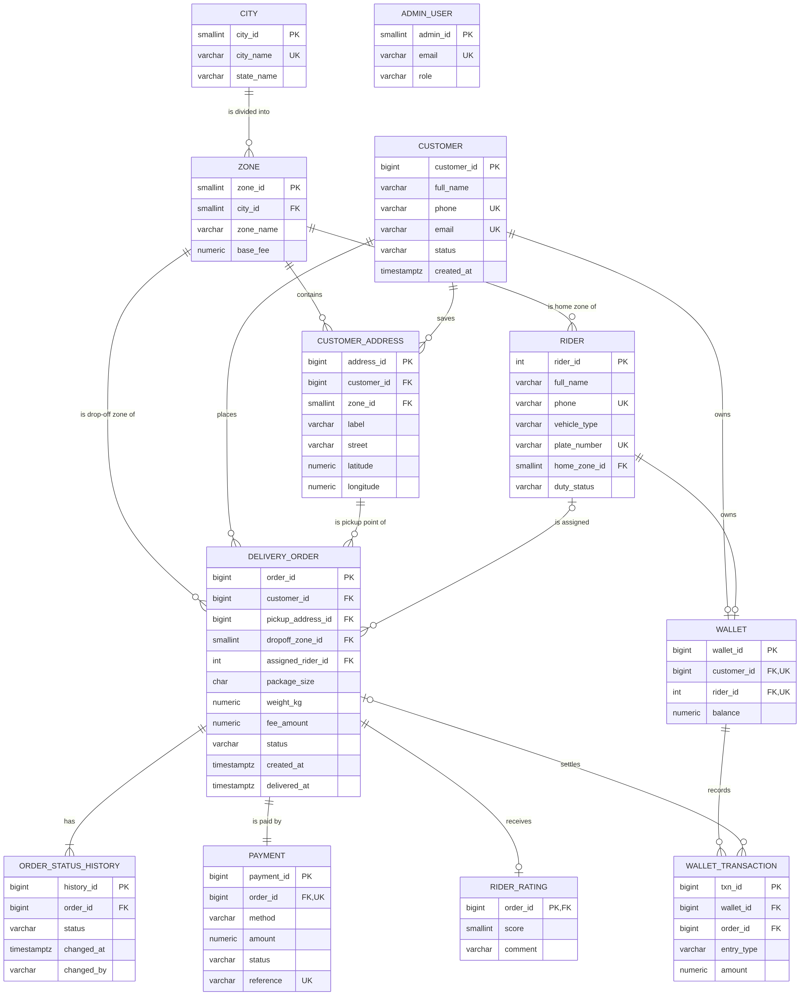
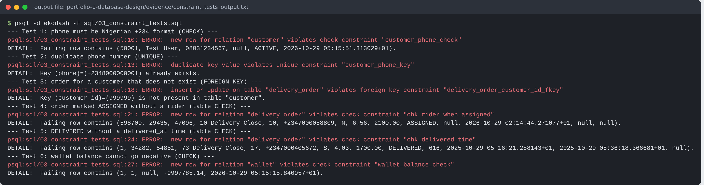

# Portfolio 1 – Database Design and Modelling

**Case study:** EkoDash Logistics Ltd, a simulated last-mile parcel delivery company operating in Lagos, Abuja and Port Harcourt.
**DBMS:** PostgreSQL 16.

## 1. The organisation

EkoDash connects people and small businesses who need a parcel moved across town with motorbike, tricycle and van riders. A customer books a pickup in the app, the dispatch system assigns a nearby rider, the rider picks the parcel up and delivers it, and the customer pays by card, bank transfer, wallet or cash and may rate the rider.

| Item | Detail |
|---|---|
| Users of the database | Customers (mobile app), riders (rider app), admin staff: dispatchers, finance, support, super-admin |
| Major data stored | Cities and pricing zones, customers and saved addresses, riders and vehicles, delivery orders, status history, payments, wallets and wallet ledger, ratings |
| Key operations | Place an order, assign a rider, update delivery status, take payment, debit/credit wallets, rate a rider, produce earnings and revenue reports |

## 2. Entity–relationship model



Source: [`diagrams/ekodash_erd.mmd`](diagrams/ekodash_erd.mmd) (Mermaid, crow's-foot notation).

Main relationships and the design decisions behind them:

* **City 1 — N Zone.** Pricing (`base_fee`) and dispatch are organised by zone, and a zone belongs to exactly one city.
* **Customer 1 — N Customer_Address.** People send from home *and* from the office, so addresses are a separate entity, not columns on `customer`.
* **Delivery_Order.** This is the central fact. It references the customer, the pickup address and the drop-off zone, and optionally (0..1) the assigned rider. The rider is optional because an order is `PENDING` before dispatch.
* **Order_Status_History.** One order has many status rows. This keeps the full audit trail (who changed what, and when) instead of overwriting a single status column.
* **Payment 1 — 1 Delivery_Order.** Enforced by `UNIQUE (order_id)` on `payment`.
* **Wallet.** A wallet belongs to *either* a customer *or* a rider. This "exclusive arc" is enforced with `CHECK (num_nonnulls(customer_id, rider_id) = 1)`.
* **Wallet_Transaction.** A ledger. Every balance change is recorded as a CREDIT or DEBIT row, so a balance can always be re-derived and audited.
* **Rider_Rating.** A weak entity identified by its order (`order_id` is both PK and FK), which also guarantees at most one rating per order.

## 3. Relational schema, keys and constraints

Full DDL: [`sql/01_schema.sql`](sql/01_schema.sql). 12 tables in schema `ekodash`.

| Constraint type | Examples in EkoDash |
|---|---|
| Primary keys | Surrogate `GENERATED ALWAYS AS IDENTITY` keys on all main tables; natural key `order_id` on `rider_rating` |
| Alternate (UNIQUE) keys | `customer.phone`, `customer.email`, `rider.plate_number`, `payment.reference`, `payment.order_id`, `(zone.city_id, zone_name)` |
| Foreign keys | 14 FKs; `ON DELETE CASCADE` only where the child cannot exist alone (addresses, history); the default `RESTRICT` protects orders, payments and riders |
| Domain CHECKs | Nigerian phone format `^\+234[0-9]{10}$`, status enumerations, weight 0–50 kg, score 1–5, coordinates inside Nigeria |
| Business-rule CHECKs | `chk_rider_when_assigned` (an assigned/picked/delivered order must have a rider), `chk_delivered_time` (DELIVERED ⇔ `delivered_at` is set), `chk_time_order`, wallet `balance >= 0` (no overdraft) |

**Money** is stored as `NUMERIC(10,2)`, never floating point, so naira amounts are exact.
**Time** is stored as `TIMESTAMPTZ`, so all times are unambiguous across servers.

### Evidence: constraints really are enforced

[`sql/03_constraint_tests.sql`](sql/03_constraint_tests.sql) tries to break ten rules on purpose. The database rejected all ten and accepted the valid control insert. Full output: [`evidence/constraint_tests_output.txt`](evidence/constraint_tests_output.txt).



## 4. Normalisation

**Starting point (unnormalised).** Before EkoDash had a system, dispatchers kept a spreadsheet with one row per delivery:

`OrderNo | CustomerName | CustomerPhone | PickupAddress | PickupZone | ZoneFee | City | RiderName | RiderPhone | Vehicle | PlateNo | Statuses ("Pending 10:02, Assigned 10:15, Delivered 11:40") | PaymentMethod | Amount | Rating`

**1NF (atomic values, no repeating groups).** The `Statuses` cell holds a list, so it becomes its own relation, `ORDER_STATUS_HISTORY(order_id, status, changed_at, changed_by)`. Every other cell is already a single value.

**2NF (no partial dependency on part of a composite key).** In the history relation, the key is (`order_id`, `changed_at`), and its non-key attributes depend on the whole key. In the main sheet the key is `OrderNo`, which is a single attribute, so 2NF holds once 1NF is reached.

**3NF / BCNF (no transitive dependencies).** The sheet contains several transitive dependencies:

| Dependency found | Resolution |
|---|---|
| `OrderNo → CustomerPhone → CustomerName` | `CUSTOMER(customer_id, phone, full_name, …)` |
| `OrderNo → PlateNo → RiderName, RiderPhone, Vehicle` | `RIDER(rider_id, plate_number, full_name, …)` |
| `PickupZone → ZoneFee, City` | `ZONE(zone_id, zone_name, base_fee, city_id)` and `CITY` |
| `PickupAddress → PickupZone` | `CUSTOMER_ADDRESS(address_id, street, zone_id, …)` |
| `OrderNo → PaymentMethod, Amount` (separate business event) | `PAYMENT(order_id UNIQUE, …)` |

In every final table, each determinant is a candidate key, so the schema is in **BCNF**.

**Deliberate exception.** `delivery_order.fee_amount` looks derivable from `zone.base_fee`, but it is not redundant. It is a *snapshot* of the price at the moment of ordering. If finance raises the Lekki fee next month, last month's orders and earnings must not change.

## 5. Data set

[`sql/02_seed_data.sql`](sql/02_seed_data.sql) generates a realistic, repeatable data set (`setseed(0.8103)`): 3 cities, 20 zones, 50,000 customers, 80,000 addresses, 1,500 riders, 600,000 orders over 12 months, 2.3 million status-history rows, 600,000 payments, 51,500 wallets and 381,340 ratings (546 MB). A consistency check confirmed that every assigned rider works in the order's pickup zone (0 mismatches).

## How to run

```bash
createdb ekodash
psql -d ekodash -f sql/01_schema.sql
psql -d ekodash -f sql/02_seed_data.sql      # about 1 minute
psql -d ekodash -f sql/03_constraint_tests.sql
```
