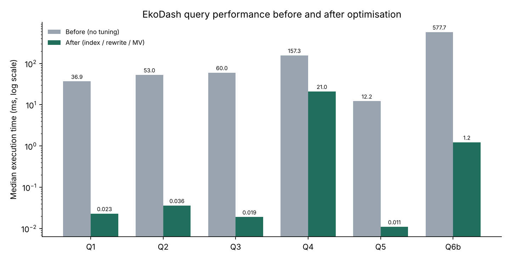
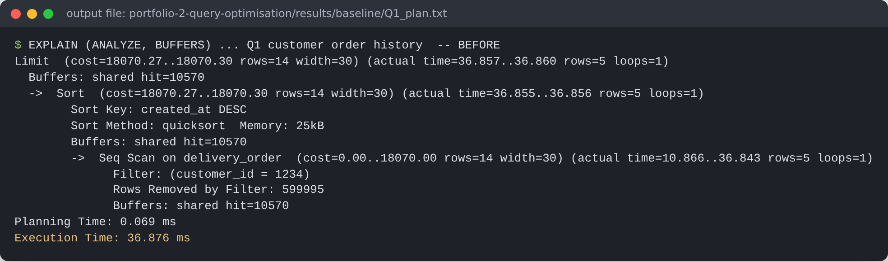
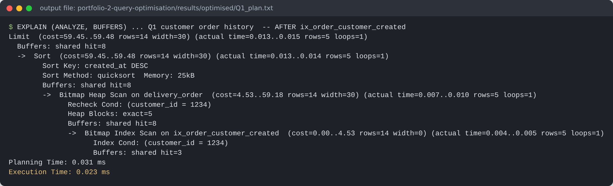
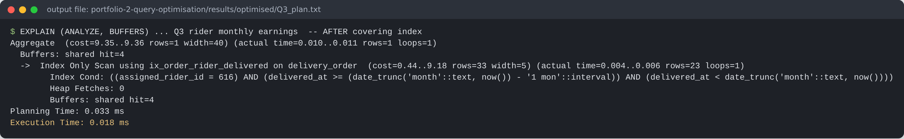

# Portfolio 2 – Query Processing and Optimisation

**Goal:** make the six queries EkoDash runs most often fast, and prove it with real execution plans.

## Method

1. The six business queries are in [`sql/01_business_queries.sql`](sql/01_business_queries.sql).
2. [`scripts/benchmark.py`](scripts/benchmark.py) runs each query with `EXPLAIN (ANALYZE, BUFFERS)`: one warm-up run, then **5 measured runs**, and records the **median**. Parallel workers are switched off so the timings are stable and comparable. Any query slower than 60 s is cancelled and recorded as a timeout.
3. Baseline run, with only primary-key, unique and FK-support indexes: `results/baseline/`.
4. Apply [`sql/02_optimisation_indexes.sql`](sql/02_optimisation_indexes.sql), run `VACUUM ANALYZE`, then re-run: `results/optimised/`.
5. A further experiment on Q6 is in [`sql/03_further_tuning_q6.sql`](sql/03_further_tuning_q6.sql).

Environment: PostgreSQL 16.15, 600,000 orders, warm cache.

## Results

| Query | Business purpose | Before (ms) | After (ms) | Speed-up | Technique |
|---|---|---:|---:|---:|---|
| Q1 | Customer "My orders" | 36.876 | 0.023 | 1,603× | Composite B-tree (customer_id, created_at DESC) |
| Q2 | Dispatcher pending queue | 52.982 | 0.036 | 1,472× | Partial index `WHERE status = 'PENDING'` |
| Q3 | Rider monthly earnings | 60.035 | 0.019 | 3,160× | Covering index `INCLUDE (fee_amount)` → index-only scan |
| Q4 | Zone revenue, last 7 days | 157.303 | 21.027 | 7× | BRIN index on `created_at` |
| Q5 | Case-insensitive e-mail lookup | 12.226 | 0.011 | 1,111× | Expression index on `lower(email)` |
| Q6a | Leaderboard, first draft (correlated) | > 60,000 (timed out) | 3,645.135 | > 16× | Q3's index lets each sub-query use an index |
| Q6b | Leaderboard, rewritten as one join | 577.663 | 556.136 | ≈1× | Rewrite; then materialized view → **1.231 ms** |



## Analysis

**Q1: from sequential scan to index scan.** Before: `Seq Scan on delivery_order … Rows Removed by Filter: 599995` read 10,570 buffers to find 5 rows. After: a `Bitmap Index Scan on ix_order_customer_created` touches 8 buffers.

The planner still adds a small `Sort` here. With only about 14 estimated rows, sorting them in memory is cheaper than an ordered index walk. For a customer with hundreds of orders, the same index lets the planner read rows already in `created_at DESC` order and stop at 20.




**Q2: partial index.** Only about 0.1% of orders are `PENDING` at any time. Indexing only those rows produced a **40 kB** index; for comparison, a full B-tree on one timestamp column of this table measured 13 MB. It stays in memory and costs almost nothing to maintain for the 99.9% of orders that are finished.

**Q3: index-only scan.** The plan shows `Index Only Scan using ix_order_rider_delivered … Heap Fetches: 0`. Because `fee_amount` is stored in the index leaf (`INCLUDE`), the SUM is answered without visiting the table at all.



**Q4: BRIN vs B-tree.** Orders are inserted in time order, so `created_at` follows the physical row order. A BRIN index stores only min/max per block range.

| Index on `created_at` | Size |
|---|---:|
| B-tree | 13 MB |
| BRIN (pages_per_range = 32) | **32 kB** (≈400× smaller) |

The trade-off is visible in the plan. BRIN is "lossy": `Heap Blocks: lossy=938` and `Rows Removed by Index Recheck: 24520`, meaning the block ranges contain some older rows that must be filtered out. The speed-up is therefore 7× rather than 1000×. For a 7-day report over a table that grows every day, that is the right balance between index size and speed.

**Q5: expression index.** A plain index on `email` cannot serve `lower(email) = …`. The planner can use an index only when the indexed expression matches the predicate exactly.

**Q6: query rewrite, then materialized view.**
* *6a* (correlated sub-queries) re-ran three sub-queries for each of the 1,500 riders. Without an index on `assigned_rider_id`, each one was a full scan of 600,000 orders, and it did not finish in 60 s. After the Q3 index existed, it took 3.6 s, but still 1,500 × 3 index probes.
* *6b* rewrites it as a single join + `GROUP BY` + `HAVING`: 578 ms. Indexes do not help further, because a leaderboard genuinely reads every rating.
* The plan showed `Batches: 4 … temp written=3119`: the hash table spilled to disk with the default `work_mem = 4MB`. Raising `work_mem` to 64 MB removed the spill (`Batches: 1`) but saved only about 4% (556 → 537 ms). The work itself, not the disk spill, was the cost.
* Because the leaderboard only needs to be fresh hourly, a **materialized view** pre-computes it: **1.231 ms** per read. `REFRESH MATERIALIZED VIEW CONCURRENTLY` costs 378 ms and does not block readers. A check query confirmed that the view returns exactly the same top 10 as Q6b.

## The cost side of indexing

Indexes are not free. Every `INSERT` into `delivery_order` now also updates 5 extra indexes, and together they use about 41 MB ([`results/index_sizes.txt`](results/index_sizes.txt)). Each index was therefore added for a named, frequent query, rather than "indexing everything". The partial and BRIN indexes were chosen partly because they are cheap to maintain.

## How to run

```bash
python3 scripts/benchmark.py baseline
psql -d ekodash -f sql/02_optimisation_indexes.sql
python3 scripts/benchmark.py optimised
psql -d ekodash -f sql/03_further_tuning_q6.sql
```
