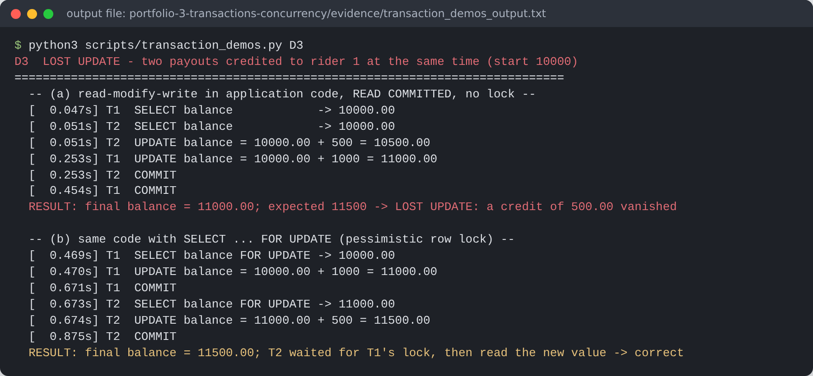
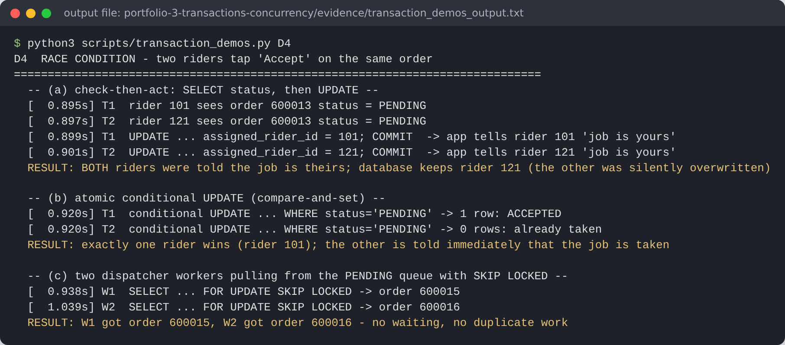
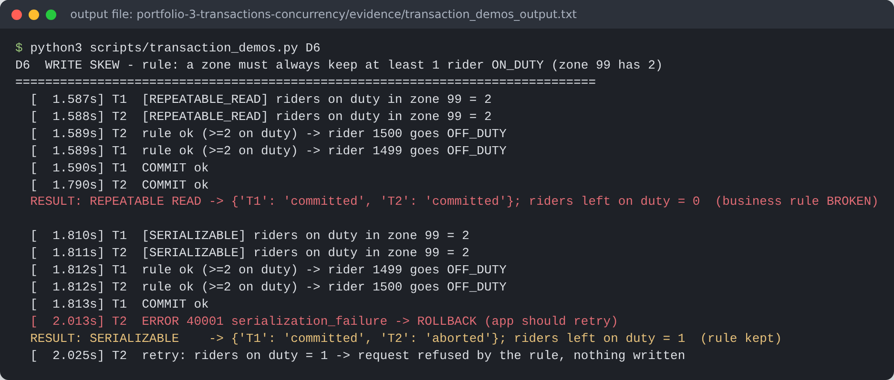
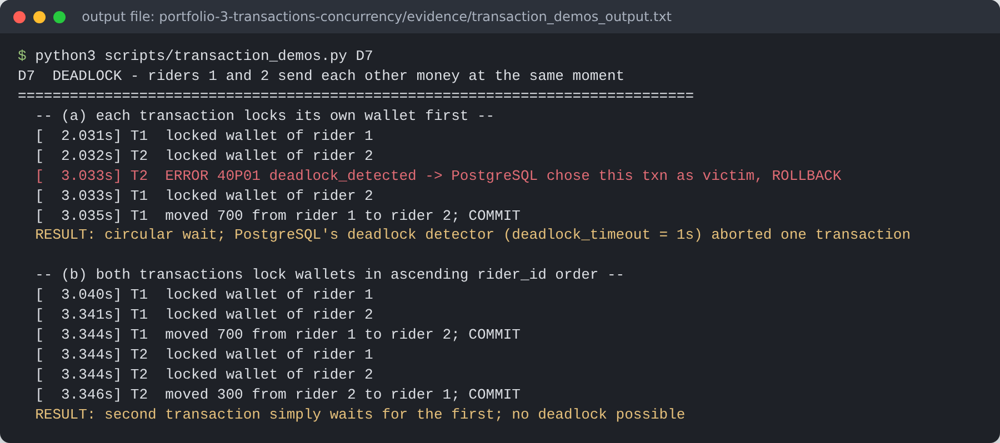

# Portfolio 3 – Transactions and Concurrency

**Goal:** show how EkoDash's money and dispatch operations stay correct when many riders, customers and staff act at the same time.

All demonstrations are in one script, [`scripts/transaction_demos.py`](scripts/transaction_demos.py) (Python 3 + psycopg 3, PostgreSQL 16). Each concurrent demo opens **two real database sessions** in two threads and uses `threading.Event` to force the problem interleaving, so every anomaly is reproduced every time rather than by luck. Full output: [`evidence/transaction_demos_output.txt`](evidence/transaction_demos_output.txt).

| # | Scenario at EkoDash | Problem shown | Control mechanism | Outcome |
|---|---|---|---|---|
| D1 | Customer books and pays from wallet | 5 statements must succeed together | `BEGIN … COMMIT` | Balance 5000 → 3000; order, payment and ledger rows all present |
| D2 | Customer with ₦300 books a ₦2,000 delivery | Failure halfway through | `CHECK (balance >= 0)` → `ROLLBACK`; `SAVEPOINT` | Order insert that had already run was undone; with a savepoint, only a bad rating was discarded |
| D3 | Two payouts credited to one rider at once | **Lost update** under READ COMMITTED | `SELECT … FOR UPDATE` | ₦500 vanished (11000 instead of 11500); with the row lock: 11500 ✔ |
| D4 | Two riders tap "Accept" on one job | **Race condition** (check-then-act) | Conditional `UPDATE … WHERE status='PENDING'`; `FOR UPDATE SKIP LOCKED` | Both riders told "job is yours" → fixed: exactly one wins; two dispatch workers take different orders without waiting |
| D5 | A quote is calculated while finance changes a fee | **Non-repeatable read** | REPEATABLE READ (MVCC snapshot) | READ COMMITTED saw 1500 then 1700; REPEATABLE READ saw 1500 both times |
| D6 | Two riders in a zone go off duty at once | **Write skew** (rule "≥ 1 rider on duty") | SERIALIZABLE (SSI) + retry | REPEATABLE READ left **0** riders on duty; SERIALIZABLE aborted one with `40001` → 1 rider left ✔ |
| D7 | Riders 1 and 2 send each other money | **Deadlock** | Lock rows in a fixed order | `40P01 deadlock detected` after `deadlock_timeout` (1 s); with ordered locking, no deadlock |

## Key evidence

**D3 – lost update and fix**


**D4 – double assignment race**


**D6 – write skew: REPEATABLE READ vs SERIALIZABLE**


**D7 – deadlock and ordered locking**


The server log independently confirms the deadlock and the two waiting processes: [`evidence/postgres_server_log_deadlock.txt`](evidence/postgres_server_log_deadlock.txt).

## Discussion

* **Atomicity (D1, D2).** The "pay for an order" operation touches four tables. If the wallet debit fails, the already-inserted order row is rolled back as well, so the system never holds an unpaid order that looks paid. Savepoints let an optional step (a rating) fail without throwing away the payment.
* **Why D3 happens in PostgreSQL's default isolation.** In D3 the application read the balance, added in Python, and wrote back an absolute value. READ COMMITTED allowed both sessions to read 10,000. When T1's `UPDATE` waited for T2's row lock and then ran, it overwrote T2's result with a value computed from stale data. Two fixes work. One is a pessimistic `SELECT … FOR UPDATE`, as shown. The other is to let the database do the arithmetic (`SET balance = balance + 500`), which takes the row lock and re-reads the current value.
* **Compare-and-set (D4).** Putting the condition inside the `UPDATE` makes "check" and "act" one atomic step. The second rider's statement matches 0 rows, and the app can tell them immediately. `SKIP LOCKED` turns the orders table into a work queue: each dispatcher worker takes a different pending order instead of queuing behind the same lock.
* **Isolation levels are a trade-off (D5, D6).** PostgreSQL's REPEATABLE READ is snapshot isolation. It prevents non-repeatable reads, but not write skew, because the two transactions update *different* rows. Only SERIALIZABLE (Serializable Snapshot Isolation) detected the dangerous read-write dependency and aborted one transaction. The cost is that the application **must retry** on SQLSTATE `40001`. On retry, the request correctly saw only one rider left and was refused.
* **Deadlocks (D7).** PostgreSQL detects the cycle and aborts one victim, so the system recovers, but the user sees an error. Acquiring locks in a consistent order (lowest `rider_id` first) removes the cycle entirely, and the second transfer simply waits.

**Design rule adopted for EkoDash:**

| Operation type | Approach |
|---|---|
| Money movements | Atomic SQL arithmetic or `FOR UPDATE`, with ordered locking |
| Rider assignment | Conditional `UPDATE` / `SKIP LOCKED` |
| Cross-row business invariants (zone cover) | SERIALIZABLE with automatic retry |
| Everything else | Default READ COMMITTED |

## How to run

```bash
pip install "psycopg[binary]"
python3 scripts/transaction_demos.py            # all demos (≈4 s)
python3 scripts/transaction_demos.py D3 D6      # selected demos
```

The script creates its own small fixtures (a demo zone 99, fixed wallet balances) and removes them afterwards.
