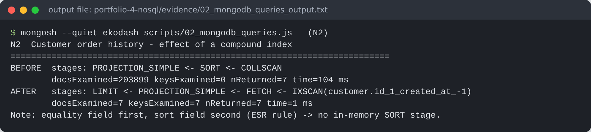
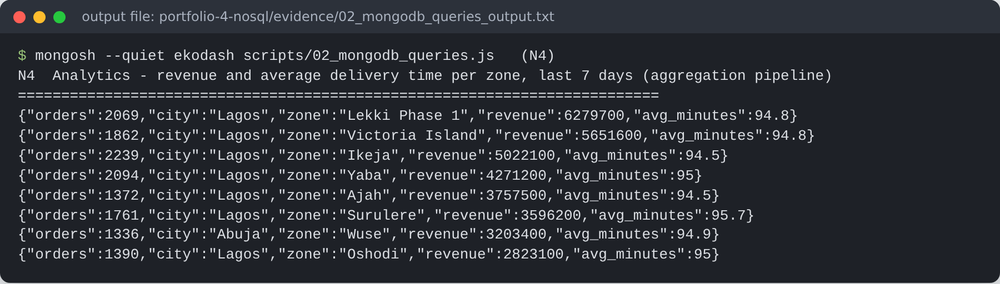
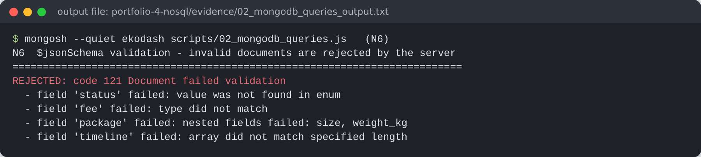
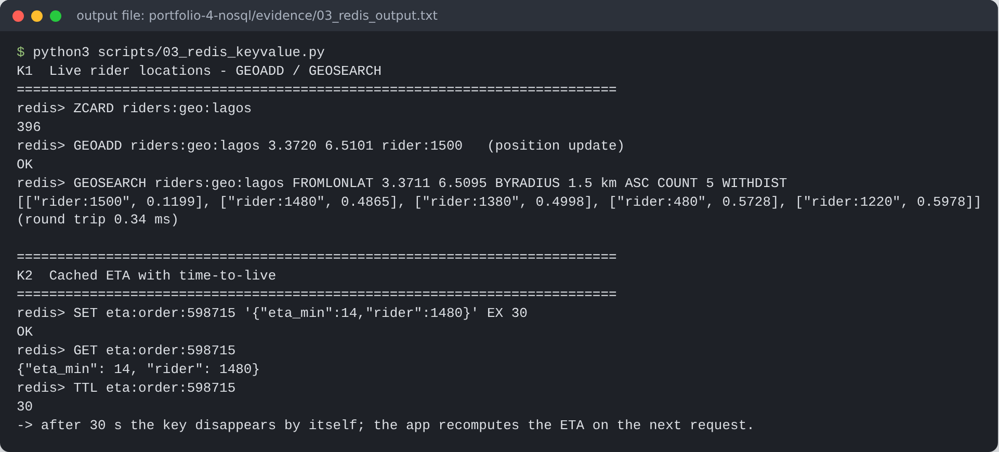

# Portfolio 4 – NoSQL and Advanced Data Models

**Goal:** model the same EkoDash case study with two NoSQL models, a **document** model (MongoDB 7.0) and a **key-value** model (Redis 8), and explain where each fits better than, or worse than, the relational model of Portfolio 1.

## 1. Why EkoDash needs more than one model

| Workload | Characteristics | Best fit |
|---|---|---|
| Payments, wallets, earnings | Strict ACID, multi-row invariants, audits | **PostgreSQL** (Portfolios 1–3) |
| Live order tracking screen | Read one whole order + timeline many times per minute; shape varies (notes, proof-of-delivery photo, failed-attempt reasons) | **MongoDB** document |
| Rider GPS positions, ETA cache, OTP limits | Thousands of tiny writes per second, only the latest value matters, data can expire | **Redis** key-value |

This is *polyglot persistence*: each store does the job it is best at, and PostgreSQL remains the system of record.

## 2. Document model (MongoDB)

[`scripts/01_migrate_to_mongodb.py`](scripts/01_migrate_to_mongodb.py) reads the relational data and reshapes the most recent 90 days into three collections.

| Collection | Documents | Avg size | Design |
|---|---:|---:|---|
| `orders` | 203,899 | 896 B | **Aggregate** = order + embedded status `timeline[]`, `payment`, `rating`, pickup/drop-off snapshot, rider snapshot |
| `riders` | 1,500 | 233 B | GeoJSON `location` (Point) with a `2dsphere` index |
| `customers` | 50,000 | 363 B | Addresses embedded as an array |

**Embed vs reference.**
* *Embedded:* the timeline (bounded at about 4–6 entries, always read together with its order), payment (1:1) and rating (0..1).
* *Snapshotted:* customer name and phone, and rider name and vehicle, copied into the order. The tracking screen should show *who delivered it at the time*, even if the rider later changes their phone number.
* *Not embedded:* a customer's orders inside the customer document. That array would grow without limit (towards MongoDB's 16 MB document cap), so orders reference `customer.id` instead.

**Schema validation.** The orders collection has a server-side `$jsonSchema` validator: status enum, `fee` stored as `Decimal128` (never float), package size and weight limits, rating 1–5, and at least one timeline entry. It proved useful straight away. On the first migration run it **rejected** the orders created by the Portfolio 3 demos, because those had no status-history rows. The migration now rebuilds a minimal timeline for such orders. This is a real example of a document database still enforcing data quality.

### Queries and evidence ([`scripts/02_mongodb_queries.js`](scripts/02_mongodb_queries.js), output in [`evidence/02_mongodb_queries_output.txt`](evidence/02_mongodb_queries_output.txt))

| # | Query | Result |
|---|---|---|
| N1 | Tracking screen: `findOne({_id})` | `IDHACK` plan, **1 document examined**, 0 ms. The relational version joins 8 tables. |
| N2 | Customer history, sorted, limit 20 | Before: `COLLSCAN`, 203,899 docs examined, 141 ms. After the `{customer.id:1, created_at:-1}` index (equality → sort, the ESR rule): `IXSCAN`, **7** docs, 1 ms, no in-memory SORT |
| N3 | Dispatch: 5 nearest on-duty bikes within 3 km of a Yaba pickup | `$geoNear` using `location_2dsphere`; nearest 487 m |
| N4 | Revenue and average delivery minutes per zone (7 days) | Aggregation pipeline `$match → $group → $sort`, with `$dateDiff` |
| N5 | Rider picks up a parcel | One `updateOne` with `$set` + `$push` is **atomic on a single document**. A second rider's identical update matched 0 documents (compare-and-set, as in Portfolio 3 D4) |
| N6 | Insert an invalid order | Rejected, code 121: status not in enum, fee wrong type, package fields, empty timeline |





## 3. Key-value model (Redis)

[`scripts/03_redis_keyvalue.py`](scripts/03_redis_keyvalue.py), output in [`evidence/03_redis_output.txt`](evidence/03_redis_output.txt).

| Key pattern | Redis type | Use |
|---|---|---|
| `riders:geo:lagos` | GEO (sorted set) | `GEOADD` on every GPS ping; `GEOSEARCH … BYRADIUS 1.5 km ASC COUNT 5` returned the 5 nearest riders in **0.34 ms**; 396 riders use 34.5 kB |
| `eta:order:<id>` | String + `EX 30` | Cached ETA expires by itself after 30 s |
| `ratelimit:otp:<phone>` | Counter, `INCR` + `EXPIRE NX` in `MULTI/EXEC` | Requests 1–3 sent, 4–5 blocked for 10 minutes |
| `rider:<id>:session` | Hash + TTL | Rider app heartbeat and session fields |



## 4. Suitability: honest comparison

| Criterion | PostgreSQL | MongoDB | Redis |
|---|---|---|---|
| Read a whole order for tracking | 8-table join | **1 document read** | – |
| Evolving fields (photos, notes) | Needs ALTER TABLE / JSONB | **Flexible**, validator controls the rules | – |
| Multi-entity money transactions | **Native ACID** | Supported (multi-document transactions on replica sets, see Portfolio 5 M4), slower, best avoided in hot paths | No |
| Ad-hoc joins and reporting | **Strong** | `$lookup` exists but is weaker | No |
| High-frequency, short-lived data | Write amplification (WAL, indexes, vacuum) | Acceptable | **Ideal**: in memory, TTL |
| Durability | Strong | Strong with `w:"majority"` | Configurable; here a cache, so losing it is acceptable |

**Trade-offs accepted.** Snapshot fields duplicate data, so a rider's new name is not back-filled into old orders (this is intended). Mongo's copy of an order is *derived* from PostgreSQL, so it is eventually consistent with the system of record. In production it would be fed by change-data-capture rather than a batch script.

## How to run

```bash
mongod --dbpath /srv/mongo/p4 --port 27017 --fork --logpath /srv/mongo/p4.log
redis-server --port 6379 --daemonize yes
pip install pymongo redis "psycopg[binary]"
python3 scripts/01_migrate_to_mongodb.py
mongosh --quiet ekodash scripts/02_mongodb_queries.js
python3 scripts/03_redis_keyvalue.py
```
