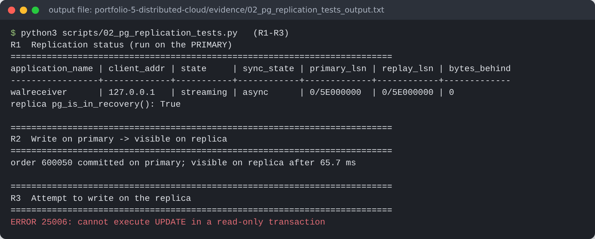
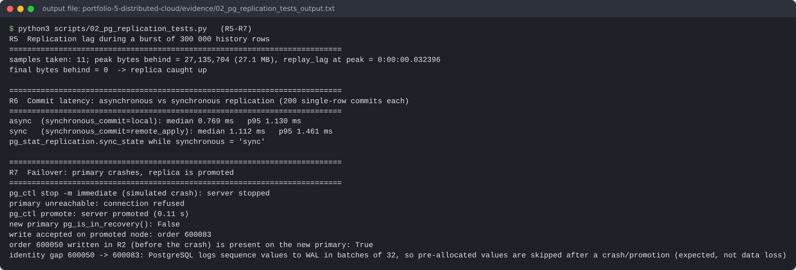
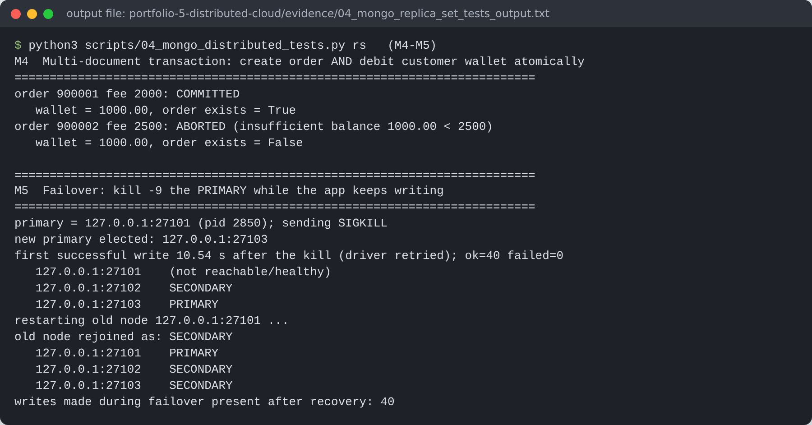
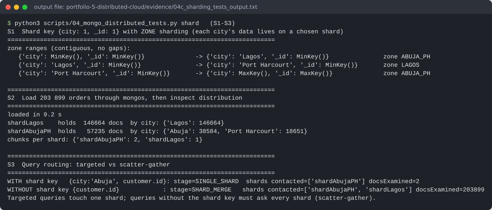
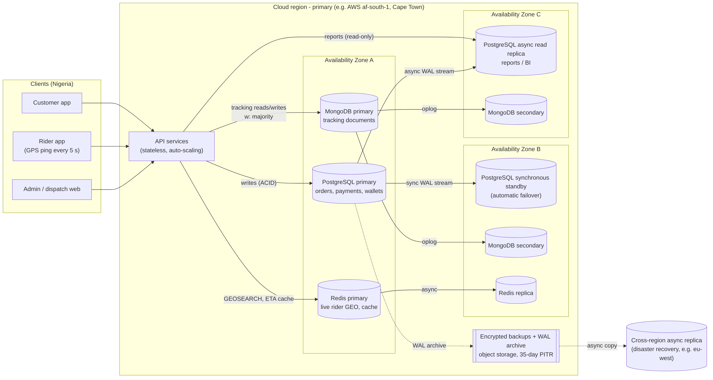

# Portfolio 5 – Distributed and Cloud Database Exercise

**Goal:** show, with working setups, how EkoDash's data stays available and scales beyond one server (replication, failover, sharding), and design a cloud deployment for production.

Everything below was **actually deployed and tested**. Each node is a separate database process on its own port on one Linux host. The commands are the same ones used across separate servers; only the host names would change.

| Topology | Nodes | Scripts |
|---|---|---|
| PostgreSQL 16 streaming replication | primary :5432 → hot standby :5433 | [`01_setup_pg_replication.sh`](scripts/01_setup_pg_replication.sh), [`02_pg_replication_tests.py`](scripts/02_pg_replication_tests.py) |
| MongoDB 7 replica set `ekors` | 3 members :27101–27103 | [`03_setup_mongo_cluster.sh`](scripts/03_setup_mongo_cluster.sh), [`04_mongo_distributed_tests.py`](scripts/04_mongo_distributed_tests.py) `rs` |
| MongoDB 7 sharded cluster | config RS :27201, shards `shardLagos` :27301 and `shardAbujaPH` :27302, `mongos` :27200 | same files, `shard` |

## A. PostgreSQL replication and failover

Output: [`evidence/02_pg_replication_tests_output.txt`](evidence/02_pg_replication_tests_output.txt)

| Test | Result |
|---|---|
| R1 Status | `pg_stat_replication`: state `streaming`, `async`, 0 bytes behind. The replica was cloned with `pg_basebackup -R` and a physical replication slot, so the primary keeps WAL until the replica has received it |
| R2 Propagation | An order committed on the primary was visible on the replica after **65.7 ms** (2.2 ms in an earlier run; the figure varies with load and the polling interval) |
| R3 Read-only standby | `UPDATE` on the replica → `ERROR 25006: cannot execute UPDATE in a read-only transaction` |
| R4 Read scaling | The weekly revenue report ran on the replica (44.7 ms) and put no load on the primary |
| R5 Lag under load | Bulk insert of 300,000 rows: peak **27.1 MB** of WAL behind, `replay_lag` 32 ms, back to 0 when the burst ended |
| R6 Sync vs async | Median commit **0.77 ms async vs 1.11 ms synchronous** (`remote_apply`). Synchronous replication means zero data loss on failover, at the cost of every commit waiting for the standby (here on the same host; across zones add the network round-trip) |
| R7 Failover | Primary killed (`pg_ctl stop -m immediate`). Replica promoted in **0.11 s** and accepted writes. The order from R2 survived |




*Observation:* the order IDs jumped from 600050 to 600083 after the failover. PostgreSQL logs sequence values to WAL in batches of 32, so pre-allocated values are skipped after a crash. Gaps in identity columns are normal and must not be used for business meaning, for example as invoice numbering without gaps.

## B. MongoDB replica set (availability + tunable consistency)

Output: [`evidence/04_mongo_replica_set_tests_output.txt`](evidence/04_mongo_replica_set_tests_output.txt)

| Test | Result |
|---|---|
| M2 Write concern | `w:1` median **1.20 ms** vs `w:"majority"` **3.14 ms**. The majority write cannot be rolled back if the primary fails; a `w:1` write can |
| M3 Read scaling | `readPreference: secondary` + `readConcern: majority`: the query was served by `127.0.0.1:27102 (SECONDARY)`. The 1,000 orders counted are the M2 test documents, all historical deliveries |
| M4 Multi-document ACID transaction | Order insert + wallet debit across two collections: ₦2,000 committed (wallet 3,000 → 1,000); ₦2,500 aborted, so neither the order nor the debit was saved |
| M5 Automatic failover | Primary killed with `SIGKILL` while the app wrote every 250 ms. The secondaries elected `27103`. The first write succeeded **10.5 s** after the kill, which is MongoDB's default `electionTimeoutMillis` of 10 s plus the election itself. **40 of 40 writes succeeded**, because the driver waited and retried (`retryWrites`). The restarted node rejoined as SECONDARY and, having `priority: 2`, took back the primary role once it caught up |



## C. MongoDB sharding by city (horizontal scale + data locality)

Output: [`evidence/04c_sharding_tests_output.txt`](evidence/04c_sharding_tests_output.txt)

* **Shard key `{city: 1, _id: 1}` with zone sharding.** Lagos orders live on `shardLagos`; Abuja and Port Harcourt live on `shardAbujaPH`.
  * *Why city first:* almost every operational query (dispatch, tracking, city dashboards) filters by city, so it can be routed to one shard.
  * *Why `_id` second:* it gives high cardinality, so a city can still be split into many chunks as it grows.
  * *Zones* would also let a future Lagos-only shard sit in a data centre closer to Lagos.
* **Distribution after loading 203,899 orders:** shardLagos 146,664 (Lagos only); shardAbujaPH 57,235 (Abuja 38,584 + Port Harcourt 18,651).
* **Routing:**
  * `find({city: "Abuja", "customer.id": …})` → `SINGLE_SHARD`, 1 shard contacted, **2 documents examined** (after adding the index `{city, customer.id, created_at}`).
  * `find({"customer.id": …})` with no shard key → `SHARD_MERGE`, both shards contacted (scatter-gather).



**Lesson learnt from the first attempt** ([`evidence/04b_sharding_first_attempt_gapped_zones.txt`](evidence/04b_sharding_first_attempt_gapped_zones.txt)). I first declared one zone range per city with gaps between them. The cluster then kept small empty "gap" chunks on the *other* shard. A query for `city = "Abuja"` covers the range `[{Abuja, MinKey}, {Abuja, MaxKey}]`, which includes its upper end. That upper end equals the first key of the following gap chunk, so mongos still contacted **both** shards (`SHARD_MERGE`). Re-declaring the zones as ranges that cover the whole key space with no gaps fixed it (`SINGLE_SHARD`).

**Known weakness of this key:** Lagos holds about 72% of all orders, so a single Lagos shard would become a hot spot. The next step would be to add shards to the LAGOS zone, letting the balancer split Lagos chunks by `_id` across them.

## D. Consistency vs availability (CAP / PACELC) for EkoDash

| Data | Choice | Reason |
|---|---|---|
| Wallets, payments | **CP**: PostgreSQL synchronous standby; MongoDB `w:majority` + `readConcern: majority` | A double-spent wallet is worse than a few seconds of unavailability |
| Order tracking | Leans **AP**: reads from secondaries/replicas are allowed | A tracking screen that is half a second stale is acceptable; an unavailable one is not |
| Live rider locations | **AP**: Redis with an async replica | Positions are overwritten every 5 s, so losing a few is harmless |

PACELC adds the "else" case: even with no network partition there is a trade-off between latency and consistency. R6 and M2 measured that trade-off directly: synchronous or majority acknowledgement roughly doubled to tripled commit latency.

## E. Proposed cloud deployment



* **Region:** I could not confirm a full hyperscale cloud *region* inside Nigeria. AWS announced a **Local Zone in Lagos** in 2023 (Connecting Africa, 2023). That is a small extension of a parent region, with a limited set of services, which suits latency-sensitive compute such as the API tier. The nearest full regions are in South Africa (for example AWS `af-south-1` Cape Town or Azure South Africa North) and in Europe. The design therefore puts the API in or near Lagos, the managed databases in a South African region, and disaster recovery in Europe. A Lagos colocation provider remains an option if regulators or customers require the databases to be hosted in Nigeria.
* **Data protection:** customer phone numbers and addresses are personal data under the Nigeria Data Protection Act 2023. Storing them outside Nigeria requires a lawful basis for cross-border transfer and adequate safeguards, so the design keeps encryption at rest (KMS), TLS in transit and access logging.
* **Managed services:** a managed PostgreSQL service with a Multi-AZ synchronous standby (automatic failover, like R7, but orchestrated by the provider) and an async read replica for reports (R4). MongoDB Atlas, or self-managed replica sets, spread across three availability zones (M5). A managed Redis with a replica.
* **Backups:** daily snapshots + continuous WAL archiving, giving point-in-time recovery, retained for 35 days and copied to the DR region.
* **Targets:**
  * Payments: RPO 0 within the region (synchronous standby).
  * Other data: RPO ≤ 5 minutes across regions.
  * RTO ≤ 2 minutes for automated in-region failover. The measured failovers were 0.11 s to promote PostgreSQL (manual trigger) and about 10.5 s for MongoDB's automatic election.

## How to run

```bash
bash scripts/01_setup_pg_replication.sh
python3 scripts/02_pg_replication_tests.py      # note: R7 promotes the replica
bash scripts/03_setup_mongo_cluster.sh
python3 scripts/04_mongo_distributed_tests.py   # needs the Portfolio 4 MongoDB (:27017) as data source
```
